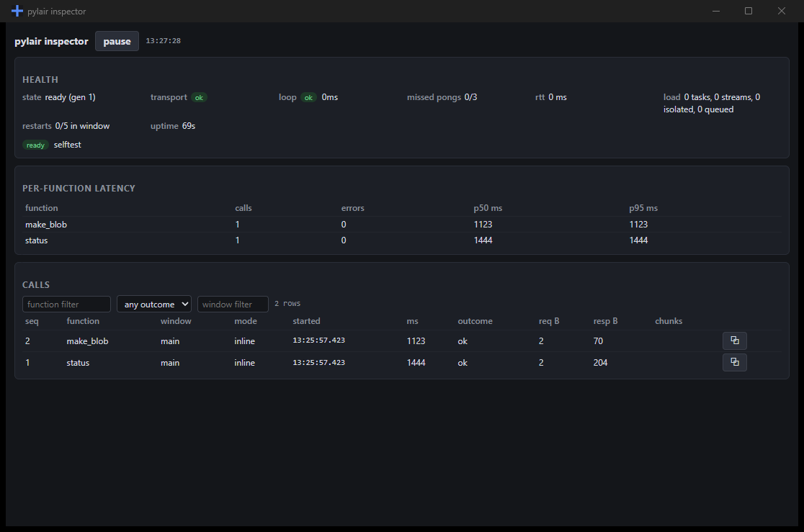

# Live inspector (dev builds only)

The inspector is a dev-only window into the supervisor: what calls are
running, how long they take, how they ended, and what the runtime's
health and warm pools look like — live, while you develop.

```
pylair dev --inspect
```

That sets `PYLAIR_INSPECT=1` for the dev process and prints a line
saying the inspector window will open. `--inspect-payloads` (or
`PYLAIR_INSPECT_PAYLOADS=1`) additionally enables payload previews.
Neither flag has any effect on `pylair build`.

## What you get



A separate window titled **pylair inspector** opens next to your app
once it starts. It polls the host every ~250 ms and shows:

- **Timeline** — one interleaved view of everything the inspector
  knows, newest first: calls, lifecycle events, Python stderr lines,
  codegen results and permission denials. Filter by kind with the
  checkboxes. Every row expands on click.
- **Calls** — the last 1000 calls (oldest dropped), newest first:
  function, window, mode (`inline`/`isolated`/`warm`), start time,
  latency, outcome, request/response sizes, and for streams the chunk
  count. Filter by function, outcome or window; errors, cancellations
  and limit refusals are highlighted. Rows expand to the same detail
  as in the timeline; the copy button puts the row's JSON on the
  clipboard. **Pause** freezes the display.
- **Per-function latency** — call count, error count, p50/p95 latency
  over the recorded window.
- **Health** — the `health()` snapshot: transport and loop verdicts,
  missed pongs, RTT, load totals, restart accounting, app-readiness
  components, and the update state for updater-enabled apps.
- **Warm pools** — per-function pool status (see below).

## The timeline

The timeline correlates what happened, in order, across four kinds of
entries. Ordering is exact: calls, events and stderr lines share one
sequence counter, so a restart always sorts between the stderr lines
that preceded it and the ones that followed.

**Lifecycle** entries are the supervisor's own story:

| event | meaning |
|---|---|
| `spawn` | a runtime generation spawned — generation number and pid |
| `exit` | the generation ended — the exit detail (code or signal) or the kill reason |
| `restart` | the supervisor decided to respawn — the crash reason is the why |
| `breaker` | the crash breaker tripped; the runtime parks Failed instead of restarting |
| `dev reload` | hot reload fired — names the changed file when the CLI reported one |
| `warm spawn/death/reap` | warm-pool member churn |
| `stall` / `recovered` | the loop-stall warning fired, and when the loop freed |

Warm-pool entries are diffed off the pong-carried pool stats — the
host's only window into member churn (pools are runtime-side).
Approximate by construction: several spawns inside one ping interval
arrive as one entry with a count.

**stderr** entries are the runtime's own stderr lines, generation-tagged
and timestamped. A call row expands to the lines inside its time
window — labeled *stderr during this call*, not *from* it: attribution
is by time window, not causation. Lines are capped and the ring is
bounded separately from lifecycle entries, so a log burst evicts old
stderr but never a spawn or a breaker.

**Failed calls explain themselves.** An error row shows the wire error
code and message, plus — when the runtime enriches them — the Python
traceback (monospace, in the expanded row), the suggestions list and
the per-field errors (`path`/`expected`/`received`). These are
dev-only optional `error.data` fields: the inspector displays whatever
is present and never depends on any of it existing.

**Codegen** entries mirror `pylair dev`'s stub regeneration. The CLI
writes `.pylair/codegen-status.json` after every attempt and points
the app at it (`PYLAIR_CODEGEN_STATUS`, dev-only by construction); the
inspector turns changes into timeline entries and, while the last
status is a failure, a banner on top of the page — a broken stub
regeneration is never buried in terminal scrollback. The banner
disappearing is the recovery signal.

**Denials.** When the host refuses a call for capability reasons (the
per-function scope check on `pylair:allow-python-call(-stream)`), the
entry carries the command, the window and its origin, the function —
and the fix: the permission identifier and `src-tauri/capabilities/`
to add it to. Tauri-level denials of an entire command never reach
the plugin and cannot be recorded.

## Reloading

`pylair dev` watches the Python source tree and restarts the runtime on
change (bridge mode) or restarts the server (wrap mode — "ready" there
means the port answered). Both modes share one watcher.

**Watch configuration** — `[tool.pylair.watch]` in pyproject.toml:

```toml
[tool.pylair.watch]
include = ["**/*.py"]   # default; globs relative to `source`
ignore  = []            # added to the built-in ignores
```

Built-in ignores always apply: `**/.venv/**`, `**/venv/**`,
`**/__pycache__/**`, `**/node_modules/**`, `**/.git/**`, editor temp files
(`**/.#*`, `**/*~`, `**/*.swp`, `**/*.tmp`, `**/4913`) and `.pylair/`
itself. Unknown keys and non-string globs are config errors. The dev
header prints the effective set.

**Terminal visibility** — one line per event: `reload: <file> changed,
restarting Python` on trigger, `reload: ready in <ms>ms (generation N)`
when the new runtime is up, a named failure line when Python exits during
startup, and a named line when the crash-loop breaker opens. The plugin
writes `.pylair/runtime-status.json` at every state transition — dev-only:
only when the CLI-set `PYLAIR_RUNTIME_STATUS` variable is present, only in
debug builds, stripped from the child environment in release.

**Manual restart** — two ways, both resetting the crash-loop breaker:

- `pylair restart` from a second terminal (errors clearly when no dev
  session is running for the app);
- `r` + Enter in the dev terminal, when stdin is a TTY. Line-buffered —
  never raw mode, so `tauri dev` keeps inheriting stdin; other input is
  ignored; skipped entirely in CI/pipes.

The breaker reset is the point: you fixed the bug, the breaker is open,
and you want the runtime back. While the breaker is parked open ANY
trigger — a file save or a manual restart — brings the runtime back (one
human attempt is not a crash loop); while the runtime is up, only the
manual marker resets the crash accounting. `pylair restart` run from a
second terminal narrates in the dev terminal too (`reload: manual
restart requested, restarting Python`, then the ready or failed line).
The dev-reload timeline entry reads "manual restart" for manual
restarts.

## Outcomes

Every recorded call ends in exactly one outcome:

| outcome | meaning |
|---|---|
| `ok` | normal result |
| `error <code>` | the wire error code (protocol-v1 §3) |
| `cancelled (verdict)` | `TASK_CANCELLED`, with the cancel verdict when the runtime reports one |
| `limit <name>` | `LIMIT_EXCEEDED`, with the `data.limit` cap name |

Calls still running show as `in flight` (blue) with a live latency.

## Payload previews

Off by default. With `--inspect-payloads` (or
`PYLAIR_INSPECT_PAYLOADS=1`) each row additionally carries a truncated
JSON preview of the input and result — at most ~512 characters.
**Blob bytes are never included**: a `{"$b64": …}` payload is shown as
a size marker (`<N bytes>`). Previews are still dev tooling — don't
enable them around data you wouldn't want in a screenshot.

## Warm pools in health()

Independent of the inspector, `health()` now carries a `pools` object
for every app (debug or release, inspector or not):

```json
"pools": {
  "transcribe": {
    "size": 2, "live": 2, "busy": 1, "idle": 1, "queued": 0,
    "deaths": 0, "crash_loop": false, "idle_ttl_s": 30.0, "reaps": 1
  }
}
```

One entry per warm-pooled function that has been used this generation:
`size` the configured pool size, `live` members alive now, `busy`/`idle`
the split of live members, `queued` calls waiting for a member,
`deaths` consecutive member deaths with no success between them,
`crash_loop` whether the pool stopped after too many deaths,
`idle_ttl_s` the configured per-member idle TTL (`null` = live until
shutdown) and `reaps` how many idle-TTL reaps have happened so far.
The runtime reports this on each pong; `pools` is `null` until the
first pong of a live generation and absent entirely for wrap-mode
(`web`) runtimes.

## How it works (and what it costs)

- The tap lives in the supervisor, recorded at call start and end. It
  is a fixed-size ring — it never allocates unboundedly, and it never
  uses the events channel, so a burst of recorded calls cannot cost
  you real `pylair://` events.
- **Debug builds only.** Everything is behind `cfg(debug_assertions)`:
  a release build compiles a zero-sized shell instead — no ring, no
  page, no window, no command.
- **Off by default even in debug.** Without `PYLAIR_INSPECT=1` the hot
  path cost is one atomic load. With the flag on, recording uses a
  try-lock: a contended sample is dropped rather than ever blocking a
  call.
- The window loads one bundled static HTML/JS page (no framework, no
  network) over a custom URI scheme that answers **only** the inspector
  window's own label — app windows get 403. The single read-only
  command `python_inspect_snapshot` likewise refuses every window
  except the inspector's.
